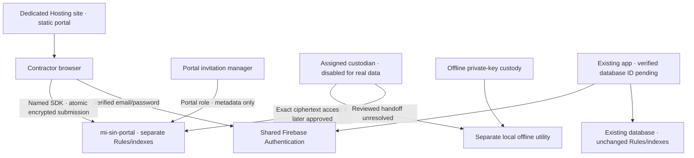

# Phase 1 — Existing Blaze project, dedicated named database

November 5, 2026. **Review proposal only. No merge, deployment, resource creation or real SIN collection.**

## Decisions and evidence

Use owner-confirmed existing Blaze project **Default Gemini Project / `gen-lang-client-0948635471`**. Do not create another project, downgrade to Spark, link/unlink billing or change any billing configuration. The target remains CAD $0 additional actual spend, with no new subscription, domain or fixed-cost infrastructure. A billable named database cannot be promised to remain $0; collection stays disabled pending financial and security approval.

Propose a new Cloud Firestore database **`mi-sin-portal`**, **Standard edition / Native mode**, and **`northamerica-northeast1` (Montréal)** subject to availability and privacy review. Toronto (`northamerica-northeast2`) is a documented Canadian alternative. The existing app's actual database ID/location are unknown; never assume `(default)`. No database has been created. No existing rule/index/Hosting/Auth configuration has been changed.

Read-only inspection was attempted with Firebase CLI 15.35.0: `firestore:databases:list --project gen-lang-client-0948635471 --json` failed with “Failed to authenticate, have you run firebase login?”. The Firebase plugin is installed, but no authenticated project-inspection tool is exposed in this session. Thus owner-confirmed Blaze is accepted as supplied context, not claimed as independently verified. Full inventory, deployed Rules, configuration, dependencies and billing usage remain pending; see [project-investigation.md](project-investigation.md).

PR #1 was open/draft/unmerged at `fe955ba7474d666a42c8eb6fd2be84e4197bb6d1`. Existing tracked files were checked against remote blobs before edits. MI CSS, 14 screen concepts, privacy analysis and all original acceptance requirements remain useful and preserved.

## Recommended architecture for this review

Keep React/Vite/TypeScript/Tailwind static frontend and shared Firebase Authentication. Give the portal its own web-app registration, Hosting site/target, named database, database-specific Rules/index files and UID-scoped application roles. These are proposals, not created resources. No Functions deployed or selected merely because Blaze exists.

| Boundary | Dedicated resource / proposed behavior | Residual sharing |
| --- | --- | --- |
| Database | `projects/gen-lang-client-0948635471/databases/mi-sin-portal` | Project IAM, billing/service quotas and privileged operators remain shared |
| Security Rules | `firestore.mi-sin-portal.rules`, deployed only to the named DB | No effect on other databases' Rules when targeted correctly; existing DB can still expose its own data independently |
| Indexes | `firestore.mi-sin-portal.indexes.json`, named DB only | Index/storage/operation charges apply; no new free quota |
| Frontend | Separate React web app and Hosting site/target `mi-sin-portal` | Auth providers/users, authorized domains, Hosting quota, owners and deployment administration are shared |
| Contractor identity | Verified Firebase email/password identity matching active invitation | Link alone, typed email or unrelated existing app role grants no portal access |
| Roles | Portal database `roles/{uid}` and exact record assignments | Project IAM/server SDK can bypass Rules; database-specific roles are not project-admin isolation |
| Cryptography | Web Crypto RSA-OAEP/SHA-256, offline private-key custody | Browser origin/endpoint/key-copy risks remain; no private key in Firebase/GitHub |
| Development | Demo project + explicit named emulator DB + synthetic existing-app sentinel | Emulator fixture is not the actual existing application's rules/configuration |
| Optional backend | Separate Functions codebase/identity only after comparison/approval | Compute/build/artifact/log/scheduler billing and IAM exposure; not part of current deploy config |

## Data flow — baseline static client

The diagram separates database data planes, not shared identity/IAM/billing. Portal code contains no handle to the existing DB. Existing app code/config is not edited. Rules on `mi-sin-portal` cannot stop a client with the same project identity from deliberately calling another DB if that other DB already allows access. See [existing-app-impact.md](existing-app-impact.md).

## Explicit SDK and deployment targeting

Every client DB handle must be initialized with an explicit named ID, for example `initializeFirestore(app, { localCache: memoryLocalCache() }, 'mi-sin-portal')`; never `getFirestore(app)` without an ID. Centralize initialization, pin project/database constants and pass the handle to all operations. Never accept a database name/project ID/collection path from a URL, user input or unreviewed environment fallback. Server SDKs, if later approved, also use `getFirestore(app, 'mi-sin-portal')` explicitly and test IAM separately because Admin SDK bypasses Rules.

The included isolation proof `src/firebase/portal-db.mjs` is emulator-only and rejects cloud projects. It demonstrates explicit named initialization and memory cache, not a finished React app. It is not linked to the non-collecting interface. `config/portal-target.mjs` also checks the proposed deployment config contains exactly the named database and no shared Auth/Functions block. Production initialization remains unimplemented until approval.

`firebase.mi-sin-portal.proposed.json` maps only this DB to its dedicated Rules/index files. No default database is configured there. The dedicated Hosting target is unbound; `dist/` does not exist as a production build. CSP currently blocks all remote connections/form submission. Do not deploy the inline-script layout prototype under this built-app configuration. [deployment-isolation.md](deployment-isolation.md) contains later-review commands, approval gates and scope verification. No executable deployment workflow is added now.

## Contractor access and atomic submission (functional design, not active cloud rules)

Finance approves collection purpose and SIN-versus-BN eligibility. InvitationManager creates random invitation ID, approved email, expiry, revision, purpose/notice version, selected public key ID and random non-SIN-derived reference. Staff send instructions using existing corporate mail. Invitation ID is routing only; any link fragment is removed promptly and contains no SIN/email. No custom mail provider or numeric OTP service is required.

Contractor signs in using the approved Firebase provider, verifies email, reloads user and refreshes token. Future functional Rules require signed email_verified, permitted provider, exact approved email, active expiry/revision and allowed policy; no public invitation list. UID is bound immutably at submission. An unrelated shared-project user gets no portal role. Auth uses memory-only persistence and Firestore memory cache; no SIN/keys/tokens/ciphertext drafts in persistent browser storage. UI idle signout complements signed auth_time checks; it is not a server HttpOnly session or MFA.

Dedicated database collections:

| Collection | Minimal purpose / access |
| --- | --- |
| `policy` | Owner-controlled approval/mode/key IDs/notice version; no client writes |
| `roles` | Portal-specific UID permissions, trusted bootstrap; no self-grant or generic existing-app admin flag |
| `invitations` | Approved email, immutable business-purpose/key metadata, expiry/revision/status; matching verified contractor get; permitted manager metadata access |
| `submissionSlots` | Permanent deterministic invitation ID slot with immutable UID/reference/time; no deletion that reopens submission |
| `submissions` | Status/retention/transfer-attestation metadata, no SIN fragments or ciphertext |
| `encryptedRecords` | Ciphertext + fixed protocol/key/context binding, no plaintext; separate from dashboard-readable documents |
| `assignments` | Explicit record/custodian/expiry from independent authority |
| `auditEvents` | Enumerated actor/reference/event/time only; no free text, SIN, tokens or raw exceptions |

A functional Rules design uses a write batch to create deterministic slot + encrypted record and paired status/event. `getAfter` validates cross-document consistency; no payload read needed for contractor submission. Updates/deletes to submitted payload/slot denied, before-state slot absence prevents concurrent duplicates, permanent slot prevents recreation after disposal. Rule lookup limits and concurrent writes need tests. The emulator model in `tests/fixtures` proves a smaller create-once subset; **it is not the full lifecycle schema or cloud deployment Rules**.

Current actual Rules candidate is deny-all, including permitted roles. This is deliberate until approval. The emulator-only model permits bounded manager invitation create and verified matching contractor submission with strict type/field/size checks; it never permits ciphertext reads. No test is evidence of production access being enabled.

## Encryption, handling and disposal

Retain browser RSA-4096 OAEP with SHA-256 and fixed label `MI-SIN-PORTAL:v1` as an independently reviewable proposal for the short payload. Store 512-byte ciphertext, use standard random encryption and independent random references; no SIN hashing or last-four index. Bound UTF-8 plaintext context (SIN string, invitation/reference/key/protocol binding) to 400 bytes, below RSA-4096/SHA-256's 446-byte limit. Client checks nine digits/Luhn after ASCII separators normalization; checksum is not identity proof. Local decryption must check context. Rules cannot inspect encrypted contents or prove data is encrypted rather than arbitrary bytes; this remains a real-collection integrity/minimization blocker.

Private key generation, encrypted offline custody/recovery, rotation and local import remain as described in [privacy-and-decisions.md](privacy-and-decisions.md). No key file, private component, passphrase or admin credential goes into Firestore, Firebase config, browser bundle or GitHub. Hosted app does not import keys. Separate reviewed offline utility/handoff is unresolved, and copied key+ciphertext cannot be revoked. Per-record private keys complicate custody and still cannot erase copies already obtained. Lost keys require new approved contractor collection, not a bypass.

Static direct-client access cannot guarantee one-time retrieval: Rules don't consume reads, and previous ciphertext remains decryptable. MFA freshness is not demonstrated; password reauth is not MFA. One-way status claim or brief UI display does not change these facts. An optional broker function could deny direct payload reads and atomically consume a **single ciphertext delivery attempt**, but not repeated local decryption after delivery. Backend options and tradeoffs are in [functions-comparison.md](functions-comparison.md).

Disposal can pair active payload deletion, permanent slot/status and audit event after an authorized transfer attestation. Rules cannot verify the external transfer. Manual cleanup cannot guarantee a deadline when no staff are present. Blaze permits evaluation of billed TTL/scheduled cleanup, but no TTL policy, scheduler job, backup/PITR or Function is enabled. TTL is asynchronous, not an exact-time erasure guarantee; old provider/device/operator copies remain. Official tax/accounting records have separate legal retention.

## Existing app protection, privacy and launch gate

Inspect the full actual database inventory, rules releases, indexes, app/Hosting deployments, Auth/providers/domains, IAM/server clients and usage/billing before provisioning. Do not change existing database Rules to protect portal data; use a separate rules release for `mi-sin-portal`. Freeze/recheck existing configuration fingerprints and app smoke tests before/after any later approved change. Do not add blanket project IAM roles or remove existing service accounts. Separate Hosting/app registrations do not isolate Auth, project admins or shared billing.

Canadian Firestore location requires privacy approval and actual availability verification. It cannot be changed in place later. Firebase Auth US processing, Hosting global infrastructure and Google/subprocessor terms still need explicit acceptance; a Canadian DB does not make the whole app Canada-only.

Financial approval must acknowledge usage charges with no second free quota and no guaranteed $0. Security/privacy approval must evidence original requirements, not waive them implicitly. No cloud writes/real collection until configuration, existing-app impact, custody/handoff, MFA, input validation, one-time operation and disposal are reviewed and demonstrated. See [requirements-gap.md](requirements-gap.md), [costs.md](costs.md) and [implementation-plan.md](implementation-plan.md).

Primary sources reviewed November 5, 2026: [named databases](https://firebase.google.com/docs/firestore/manage-databases), [database-specific Rules deploy](https://firebase.google.com/docs/rules/manage-deploy), [SDK API](https://firebase.google.com/docs/reference/js/firestore), [Standard pricing](https://cloud.google.com/firestore/pricing), [Canadian regions](https://docs.cloud.google.com/firestore/native/docs/locations), [Firebase privacy](https://firebase.google.com/support/privacy). Product capabilities are distinct from unverified live account state.
