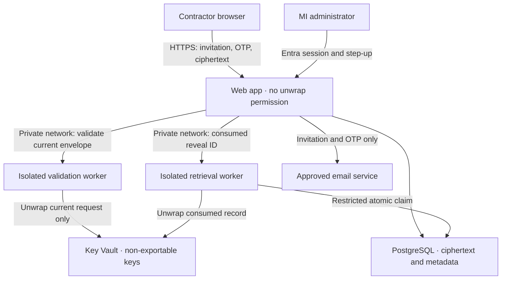

# Phase 1 — Security architecture

**Morris Interactive | Secure SIN Collection Portal**  
Proposal dated November 5, 2026. Status: design only; independent review required. No real SIN collection authorized.

## Repository inspection and scope

The connected GitHub API reported `MorrisInteractiveMaster/SINSecuredBucketProject` as public and empty, with default branch `main`. No application, AGENTS.md, dependencies, migrations, CI, or infrastructure existed to preserve. A minimal scope README initializes main; proposed work is on a review branch. Public source is compatible with this design, but repository artifacts must contain no personal information, invitation tokens, credentials, or operational incident details. Consider private visibility before development; visibility is not a security boundary for deployed software.

Phase 1 delivers architecture, data flow, threat model, screen layouts, configuration proposals, cost assumptions, and an acceptance plan. It does not implement or certify the secure service. The layout prototype cannot accept any SIN, authenticate, send mail, decrypt, or persist records. Later deliverables are explicitly tracked in implementation-plan.md.

## Recommended deployment

Use Azure Canada Central as the proposed application/data region; confirm feature availability, contract terms and recovery region before provisioning. GitHub provides source, reviews, issues and CI/CD, not the backend. Do not publish a functioning collection form on GitHub Pages or deploy this through a general-purpose preview host.

| Component | Proposed service | Reason and boundary |
| --- | --- | --- |
| Contractor and admin web app | Next.js, TypeScript, Tailwind; Linux Azure App Service | Same-origin backend-for-frontend; server session cookies; no browser access tokens; independently deployed from crypto workers |
| Confidential workers | Two private App Service applications: validation and retrieval | Distinct managed identities and routes; validation has no historical payload read permission; frontend has no unwrap permission |
| Persistence | Azure Database for PostgreSQL Flexible Server, private networking | Transactions, uniqueness constraints and conditional updates enforce one-time semantics across replicas |
| Keys | Azure Key Vault Premium, RSA-HSM per collection record | Non-exportable private keys, exact version pinning, managed identities; per-record retirement without affecting other submissions |
| Identity | MI Microsoft Entra tenant | Tenant-bound OIDC, app roles, Conditional Access, phishing-resistant MFA where available |
| Invitation/OTP delivery | Azure Communication Services Email, subject to privacy approval | Approved-domain mail; recipient and authentication message only; no SIN; geography and transit limitations require review |
| Operations | Regional Azure Monitor/Log Analytics and private audit storage | Explicit event allowlist; no body, cookie, token or plaintext capture; capped retention and alerting |
| Delivery | GitHub Actions with Azure workload identity federation (OIDC) | No long-lived cloud deployment password; protected production environment, separate nonproduction identity |

Private endpoints/VNet integration for database, vault and workers; no public database or vault data-plane access. Browser traffic uses regional HTTPS ingress with rate limits; a regional Application Gateway WAF is an optional additional boundary after traffic/cost review. If used, restrict origin to gateway and disable request-body logging. No CDN caching, third-party JS, analytics, remote fonts or session recording. TLS terminators and operators remain trusted infrastructure.

## Trust boundaries and data flow

1. An InvitationAdmin verifies collection eligibility and approved email outside this portal, records a purpose code, and creates an invitation. No self-registration or arbitrary-email form access.
2. Generate 32 random bytes for the invitation token. Store SHA-256(token), never the token. Email `/invite#token=...`; the fragment avoids ordinary access logs. First-party script clears it with history.replaceState immediately and exchanges it through POST for a short-lived pending session. Do not auto-consume the invitation on GET or email security-scanner visits. The mailbox, browser history before clearing, mail scanners and delivery service can still see the link.
3. Issue a cryptographically random 8-digit OTP to that invitation's email only. Store HMAC-SHA-256(code + challenge ID) using a managed pepper, not an unkeyed digest of a low-entropy code. Use constant-time comparison; atomic expiry, attempts and consumption. A resend invalidates the prior challenge and never resets the invitation-wide attempt cap.
4. Successful verification rotates the session identifier. Bind it to invitation ID, email revision and verified challenge; invalidate on revocation/reissue. The form and public encryption configuration are available only in this verified session. Mailbox compromise defeats both link and OTP; they are not independent MFA factors.
5. Allocate a random submission reference and a per-record Key Vault RSA-HSM key with a server-pinned version. Return only public JWK, fixed algorithm IDs and immutable AAD context. Enforce key-allocation quotas and retire abandoned keys.
6. Browser normalizes only ASCII digits, spaces and hyphens; rejects any other characters, incorrect length, all-zero and checksum-invalid values. A Luhn check is an input-quality check, not proof of issuance, ownership or identity. Keep SIN as a string. Review is local, with explicit final consent to submit; no number in a route, telemetry or browser storage.
7. Generate fresh AES-256-GCM material and a 96-bit random IV using Web Crypto for each submission attempt; fixed 128-bit tag. Bind protocol version, environment, invitation ID, submission reference and key version as canonical AAD. Wrap the AES key with RSA-OAEP using SHA-256 (Key Vault RSA-OAEP-256); send ciphertext, IV, tag, wrapped key and bounded protocol metadata. Standard Web Crypto and Azure SDK only; interoperability test vectors are a Phase 2 prerequisite.
8. A private validator unwraps only the candidate envelope supplied by the verified web session. It verifies the fixed key/version, AAD, authentication tag, nine-digit format and checksum server-side, then discards transient plaintext/key buffers. It cannot query historical payloads. It returns a short-lived, signed attestation bound to the envelope digest, invitation, reference and verification revision. In one database transaction, consume the attestation nonce, confirm invitation/session eligibility and expiry, insert one encrypted submission and consume the invitation. Failed concurrent requests create no extra record. No plaintext is returned by the validator.
9. A permitted retriever completes fresh Entra step-up, confirms the record-specific purpose, and requests a one-use reveal. The retrieval worker consumes the authorization and marks the record claimed in a committed transaction BEFORE any unwrap. Only the winning call can then obtain ciphertext, decrypt and return plaintext through an uncached response. No retry endpoint or replay of that body exists.
10. The authorized admin transfers the number manually into the approved official record. After an explicit attestation of transfer, disposal removes the active ciphertext, IV, tag, wrapped key and related credentials, retires the record key and leaves minimal metadata. Backup and key-retention limits remain documented below.

## Encryption decision and limits

**Preferred target: browser envelope encryption with isolated validation.** It keeps plaintext out of the public web app on submission and away from the database, mail and usual ingress logs. Independent security review must approve protocol encoding, library use, worker isolation and key grants before use. RSA private keys stay non-exportable in Key Vault; per-record AES data keys exist briefly in browser/worker memory. This is not end-to-end encryption excluding every MI service: validation and retrieval workers deliberately see plaintext in memory. JavaScript/GC memory zeroization is best effort; disable request dumps, heap/core dumps and sensitive crash collection.

Browser encryption alone cannot enforce SIN validity against a malicious client; that is why validation is a separate trusted service. A compromised web origin can replace JavaScript and steal future entries. TLS, CSP, controlled releases and script-free third-party policy reduce but cannot eliminate that risk. Malware, screenshots, photographs and browser extensions remain outside the application's control.

**Reviewed fallback if the protocol/isolation proof fails:** TLS submission to a dedicated validation/encryption service using vetted AES-256-GCM and per-record random data keys wrapped by Key Vault RSA-OAEP-256. This has simpler server validation but exposes plaintext to submission TLS termination, ingress and application memory. Disable body capture at every hop and obtain explicit security/privacy acceptance. Do not silently switch or claim the same client confidentiality. No SIN hashes, last-four indexes, deterministic SIN identifiers or searchable duplicates. Reference codes are independent random UUIDs.

## Identity, authorization and sessions

| Role | Allowed operations | Explicit exclusions |
| --- | --- | --- |
| InvitationAdmin | Invite, status, revoke, reissue unsubmitted invitation | No reveal, no ciphertext, no role administration |
| SINRetriever | Record-specific step-up and one-time reveal | No blanket exports; no implicit invitation authority |
| DisposalOfficer | Attest transfer and dispose permitted claimed record | No reveal solely from this role |
| Auditor | Read allowlisted audit events | No payload, token, OTP, or SIN |
| Platform operator | Infrastructure maintenance through privileged workflow | No application reveal entitlement; dangerous infrastructure/key capabilities remain separately controlled |

OIDC authorization code + PKCE, state and nonce through a maintained server-side OIDC/MSAL integration. Validate issuer, tenant, audience, signature and app roles; identify staff by stable tenant/object IDs, not email suffix. No local admin passwords or email-code admin login. Server sessions use opaque random identifiers, stored hashed; `__Host-` Secure, HttpOnly, SameSite=Lax cookies, Path=/, no Domain. Lax supports the OIDC redirect; all mutations additionally require CSRF token and strict Origin checking. Do not use GET for changes. Rotate sessions after authentication/step-up; idle and absolute expiry are enforced centrally.

For reveal, request a configured Entra authentication context protected by an enabled MFA/authentication-strength policy and appropriate sign-in frequency. Verify the signed context, server-held nonce, session/actor/record binding and fresh authentication evidence. A new token's `iat` is not fresh MFA. A bare `amr` or `acrs` claim is insufficient: Microsoft documents that a context can be issued with no policy attached. Test tenant configuration, licenses and actual challenges; deny reveal when freshness cannot be established. Bind a 60-second reveal grant to one record/session/actor; store its hash only and consume it atomically. Recheck role and session at consumption; no silent token refresh counts as step-up.

## Persistence and atomic contracts (proposed; not migration SQL)

| Entity | Minimal fields/constraints |
| --- | --- |
| invitations | UUID, authorized email, purpose code, token digest UNIQUE, revision, expires_at, revoked_at, consumed_at, created_by; email is personal data with restricted access |
| verification_challenges | invitation FK, revision, HMAC, expires_at, attempts, consumed_at; invitation-wide counters and resend windows enforced transactionally |
| sessions | hash UNIQUE, actor/invitation binding, CSRF binding, verified revision, idle/absolute expiry, step-up nonce state |
| submission_reservations | random reference, invitation FK, approved key version, AAD version, expiry; exactly one active reservation per invitation |
| submissions | random reference PK, invitation_id UNIQUE, envelope fields, validation attestation digest/nonce UNIQUE, status, received_at, retention_due_at |
| reveal_grants | digest UNIQUE, submission FK, actor, session hash, step-up evidence ID, expires_at, consumed_at |
| retrieval_attempts | submission_id UNIQUE (permanent consumption tombstone), attempt ID, actor, claimed_at, outcome; no response body |
| transfer_disposals | submission reference, transfer attestation, approved destination code, actor, timestamps, key-retirement state; no free text containing SIN |
| audit_events | event UUID, event code, random record reference, actor ID, UTC time, result; append-only writes, separately restricted retention |
| outbound_mail | approved message template, recipient, expiry and job state; no persisted raw token/code |

Invitation reissue revokes old token/challenges/sessions and bumps revision under a row lock; it cannot mutate an already-submitted invitation. A new submission after failed reveal is a new linked invitation/reference following approved recovery. No email-as-primary-key and no cross-user lookup endpoint. Rate-limit counters live in PostgreSQL with atomic increments; no process-local limiter in production.

Submission transaction locks the invitation, compares revision/expiry/revocation/consumption and verified session, consumes validation attestation, inserts the encrypted record, updates invitation and appends audit. Unique invitation FK is the final backstop. An identical retry gets a generic completed status, never a stored SIN. No decryption in dashboard queries.

Reveal uses `UPDATE ... WHERE consumed_at IS NULL AND expires_at > now() RETURNING` plus UNIQUE retrieval_attempts(submission_id) in a transaction, then commits. Only after commit may unwrap run. Grant issuance also checks no prior claim. If the commit result is ambiguous, never unwrap; recheck by attempt ID and mark recovery needed, never resume a claimed reveal. A crash, network loss or vault failure after claim leaves a terminal failed/uncertain attempt; do not unlock, regenerate a grant, or put plaintext into a retry queue. At most one application delivery attempt is enforceable, not guaranteed human observation or exactly-once transfer.

Mail delivery obtains a dispatch lease, creates token/code in memory, stores its hash/HMAC before sending, then drops plaintext. If delivery outcome is uncertain, invalidate and explicitly reissue after limits, rather than storing raw credentials in an outbox or replaying a send. Alerts contain record references only. Bulk invitation input is bounded and deduplicated, with per-recipient outcomes; no bulk SIN endpoints.

## Lifecycle, disposal and restoration

Invitation: pending → verified → submitted; pending/verified can expire or be revoked. Verification does not extend invitation expiry. Submission: awaiting_retrieval → reveal_claimed → transfer_confirmed → disposed; failed/uncertain reveal → recovery_required → disposed after approved decision. Overdue records become unavailable for retrieval at the approved deadline, then are purged by an idempotent scheduled worker. Expired invitations/challenges are rejected by request-time checks, even when cleanup is delayed.

Proposed policy values are in config/policy.proposed.json and remain unapproved. Delete active ciphertext immediately after confirmed transfer; proposed maximum untransferred retention is seven days, with restricted exceptions only if privacy approves them. Expiry alone must never falsely mark transfer complete. A record past retention that was never transferred is disposed and a new collection arranged if still legally needed.

Disposal transaction deletes envelope fields and credentials, records a tombstone and emits a key-retirement task. The Key Vault lifecycle task disables/deletes the per-record key, retries idempotently, and raises an alert on failure. Key Vault soft delete/purge protection may keep recoverable keys for their configured interval. Old WAL, replicas and backups retain encrypted material until their lifecycle completes. Neither active-row deletion nor key soft deletion is instant backup erasure.

Propose seven-day PITR backup retention where supported, no long-term backups of collection payloads, private recovery environment, and seven-day Key Vault soft-delete retention with purge protection; verify provider settings and any organizational minimums. Separate audit retention from payload retention. Database restores must replay an external disposal/consumption ledger into quarantine before any app traffic or key access; otherwise a restore can resurrect previously consumed reveals. Keep tombstones/ledger longer than the longest recoverable backup/key window. Recovery tests must prove this; restore never re-enables one-time access. Official tax/accounting records have their own legal retention and are not deleted by this portal.

## Operational controls

- HTTPS only, HSTS after domain validation, TLS to dependencies; no insecure development bypass in deployable builds.
- Strict nonce-based CSP: self scripts only, no unsafe-eval, no third-party scripts; object-src none, base-uri none, frame-ancestors none; form-action self with only needed OIDC navigation. Referrer-Policy no-referrer, X-Content-Type-Options nosniff, restrictive Permissions-Policy, no indexing (not authorization).
- All authenticated HTML/API and sensitive responses: Cache-Control no-store, private; no service worker, CDN or Next.js data caching/prefetch on protected routes. Fetch reveal by POST; no SSR of plaintext into hydration or RSC streams.
- Bound body sizes; schema validation; fixed algorithms; reject extra envelope fields, attacker-supplied key URLs, invalid tag/IV sizes or unknown versions. Parameterized SQL, exact ownership checks and deny by default.
- No request/response bodies, query strings, headers, cookies, input DOM snapshots, raw exception objects, heap dumps or SQL parameters in logs. Generic public errors, structured allowlisted events only. Email visible only to authorized dashboard roles. Short-lived keyed network buckets for abuse controls, no persistent full IP/user-agent tracking by default.
- Proposed limits: OTP five attempts/challenge, ten/invitation, 60-second resend interval, three sends/hour/invitation, ten/day/invitation; network-wide limits and capped global sends. Keys/session creation have separate quotas. Fail closed if shared counters/audit persistence are unavailable.
- Retrieval UI clears DOM/state on timeout (proposed 30 seconds), blur, navigation, pagehide and session expiry. Recheck deadline on visibility restoration; browser timer throttling means exact erasure time cannot be guaranteed. No clipboard/print/download feature. Print CSS hides the panel but cannot prevent external capture.
- Managed identities for services; least-privilege custom DB roles/procedures. Frontend cannot unwrap; validation cannot read stored envelopes; retrieval may only claim via constrained routines. Operators with code/key/database administration can bypass app-level safeguards and require separate privileged controls.
- Dependency lockfile, supported framework versions chosen at implementation, dependency review, secret scanning, CodeQL and synthetic-only integration tests. Protected branch and production environment; pinned action SHAs; no pull_request_target execution of PR code or cloud credentials in fork jobs.

## Source references reviewed November 5, 2026

- [Azure Key Vault key algorithms](https://learn.microsoft.com/en-us/azure/key-vault/keys/about-keys-details): RSA-OAEP-256 support and recommendations.
- [Entra authentication context guidance](https://learn.microsoft.com/en-us/entra/identity-platform/developer-guide-conditional-access-authentication-context): policy binding, context claims and step-up semantics.
- [ACS privacy/data residency](https://learn.microsoft.com/en-us/azure/communication-services/concepts/privacy): at-rest geography does not guarantee all processing/transit stays there.
- [OPC SIN best practices](https://www.priv.gc.ca/en/privacy-topics/sins-and-drivers-licences/social-insurance-numbers/02_05_d_21/).
- [CRA recipient identification](https://www.canada.ca/en/revenue-agency/services/tax/businesses/topics/payroll/calculating-deductions/determining-tax-treatment/set-up-and-manage-recipient-information.html).
- [CRA RC4157](https://www.canada.ca/en/revenue-agency/services/forms-publications/publications/rc4157/deducting-income-tax-on-pension-other-income-filing-t4a-slip-summary.html).
