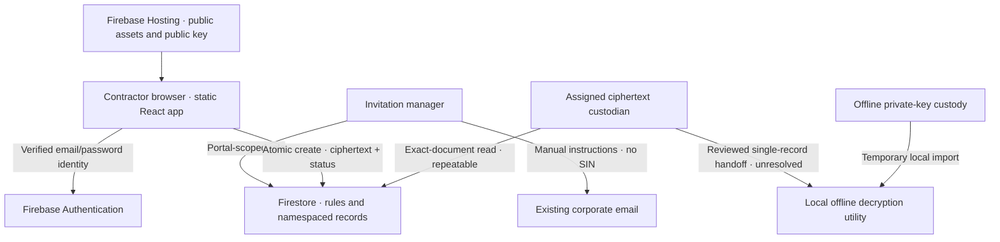

# Phase 1 revision — Firebase Spark architecture

**Morris Interactive | Secure SIN Collection Portal**  
November 5, 2026 · Design proposal · Infrastructure budget: **CAD $0** · **Synthetic-only; production blocked**.

This replaces the paid infrastructure proposal in draft PR #1. No merge, deployment, billing linkage, service activation or project modification is authorized by this revision. The existing MI layout/style, privacy analysis and original 15 acceptance requirements are retained with explicit gaps below. This is not an implementation or a claim of secure one-time retrieval.

## Feasibility decision

Use React + Vite + TypeScript, Tailwind, the modular Firebase Web SDK, Firebase Hosting (static hosting, not App Hosting), Firebase Authentication, Cloud Firestore Standard edition, Security Rules and Web Crypto. Develop using Auth/Firestore/Hosting emulators under a `demo-` project ID. No server-side framework, Functions, Run, paid mail/SMS, managed encryption service, paid database, purchased domain, billing upgrade or new subscription.

A local synthetic prototype is feasible at $0. A live Spark synthetic prototype is **conditional on project inspection**. Real SIN collection remains blocked: direct client access cannot guarantee single-use decryption, malicious clients can bypass SIN validation/encryption, and background retention deletion is not guaranteed. See [requirements-gap.md](requirements-gap.md). Passing Rules tests does not close these gaps.

## Existing-project investigation

Review PR head: `e24579c9d724dcd57580dec16a761e52494ceb01`; repository public; PR remains draft. Local source files were verified against every remote blob before editing. There is no existing Firebase configuration in this repository. That does not establish the configuration of any Firebase project.

No authenticated Firebase connection or authenticated Firebase CLI is currently available in this session. An official Firebase integration was discovered and offered; it is not yet connected. Therefore **no project's billing plan, Hosting, Authentication, database, deployed Rules, usage or IAM has been inspected**. No project is selected. Project names are not billing evidence. The read-only checklist and candidate matrix in [project-investigation.md](project-investigation.md) are required before any selection or integrated rule proposal. Evaluate Default Gemini first; move to the next candidate only after evidence shows Default is unsuitable.

## Proposed components and boundaries

| Component | Choice | Budget / security boundary |
| --- | --- | --- |
| Static frontend | React/Vite/TypeScript + Tailwind on a dedicated Hosting site | Free `web.app`/`firebaseapp.com` subdomains; separate site and deployment target, not an IAM boundary |
| Contractor identity | Firebase email/password + verified email | Manual corporate invitation instructions; Firebase verification email, no custom OTP service; no access from typed email alone |
| Storage | Existing free-quota eligible Firestore database, namespaced documents | One free database per project; no second paid database or replacing another app's database |
| Authorization | Firestore Security Rules checking signed Auth token + portal role/invitation documents | Deny unverified/unknown users; no universal authenticated-user access; project IAM/server SDK bypass remains |
| Encryption | Browser Web Crypto RSA-OAEP/SHA-256, independently reviewed public key | No secret in client bundle; private key held offline by designated custodians; no managed key service |
| Local decryption | Separately reviewed local offline utility with per-session key import | Not part of hosted portal; no embedded key, cloud key upload, or stored browser key; no one-time guarantee |
| Administration | Invitation/status UI; separate portal-scoped UID roles and per-record retrieval assignments | Same project's other users have no portal role by default |
| Development / CI | Emulator Suite and local tests; GitHub source/reviews | No live credentials for PRs; use included free Actions allowance only; no paid runners or automatic deploy |
| Email | Existing corporate mail for invitation instructions; Firebase Auth verification/reset messages | Existing service only, no incremental subscription/provider; shared Firebase mail quotas apply |

## Data flow

Private keys and SIN plaintext must never be sent to Firebase. Authentication, emails, invitation metadata and ciphertext are personal/security information. Hosting's global CDN and Firebase Auth's US processing mean that selecting a Canadian Firestore region does not make the whole system Canada-only.

## Contractor authentication and invitations

1. Finance confirms a legitimate tax/reporting purpose and whether SIN rather than BN is required. InvitationManager creates a random invitation ID and random independent display reference, approved email, purpose/notice version, expiry and selected public-key ID. Invitation ID is not authentication; no invitation bearer secret is needed with verified Auth + Rules. Send instructions manually through the existing corporate service. If the invitation ID is included, use a URL fragment, clear it promptly and never include email/SIN in a URL.
2. Contractor signs up/signs in using Firebase email/password and verifies their address through Firebase's verification action link. Do not build a custom email-code sender. Email-link sign-in is optional only if the project's five/day Spark send quota is adequate; it is not the baseline. Verification uses a Firebase link, not the original custom numeric OTP screen.
3. Reload the user and force token refresh after email verification. Rules require `request.auth != null`, signed `email_verified == true`, exact approved token email, permitted provider, active/unexpired invitation and portal policy. Require the intended verified email/password provider for this portal. Do not globally disable other existing providers or change existing users. Verify shared-provider behavior before integration.
4. UID binding at submission is immutable. Use exact email matching, with a reviewed normalization policy when invitations are created; do not strip plus addressing or dots, accept aliases by guesswork, or trust an email input parameter. An email change or recreated Auth UID never gives access to another record. A consumed invitation remains consumed regardless of new account/UID.
5. Unknown people might create Firebase Auth accounts in a shared project: Spark client signup is not an invitation-only identity service. Rules must still deny all portal data. No public list/query of invitations or roles; known invitation IDs allow only the matching verified user to get minimal invitation/status metadata. Generic errors avoid unnecessary disclosure.
6. Use `inMemoryPersistence` for portal Auth and Firestore memory cache only; no persistent IndexedDB/localStorage cache, service workers, offline drafts or retained ciphertext. Sign out on UI idle timeout. Rules compare signed `auth_time` to `request.time` for maximum authentication age; UI idle timeout alone is not server enforcement. A refreshed token `iat` is not a new login or MFA. Firebase bearer tokens are available to SDK JavaScript; this replaces, and does not satisfy, the former server HttpOnly-cookie design.

## Proposed data model (contract only; no live rules modification)

All paths below are under `/sinPortals/v1/`. Do not use existing application collections or a shared generic `users.isAdmin` field. Read the deployed full Rules and owner applications before proposing integration. The following is an isolated model for emulator proof, not a deployable replacement ruleset.

| Subcollection | Fields / proposed access |
| --- | --- |
| `policy/current` | Namespaced enabled=false gate, approved notice/purpose/version, active public key IDs, limits; no web-client writes, current phase deny all live payload operations |
| `roles/{uid}` | Explicit portal flags: invitationManager, ciphertextCustodian, disposalOfficer, auditor; owner bootstraps via trusted console/offline admin process after identity verification; no client role create/update/delete |
| `invitations/{invitationId}` | Random ID; approved email, revision, createdAt, expiresAt, purposeCode, noticeVersion, keyId, status; email immutable, revoke/reissue only pending; client never edits role/policy; exact verified contractor get only, no contractor list |
| `submissionSlots/{invitationId}` | Permanent create-once tombstone with immutable submitter UID, random reference, keyId, receivedAt=request.time; contractor create atomically with payload and status; no client delete or recreate; retain beyond all recovery windows |
| `payloads/{invitationId}` | Exact schema: version, keyId, RSA ciphertext bytes, submission binding; contractor create only; **contractor get/list/update/delete denied**, even after submission; no ordinary manager reads |
| `status/{invitationId}` | Non-sensitive lifecycle metadata only; exact own contractor get, authorized scoped admin query; narrowly permitted transitions and field allowlists; no ciphertext, SIN or last four |
| `assignments/{invitationId}` | Named custodian UID and accessUntil; optional independent approver; no self-assignment by ordinary manager/custodian; owner-managed or independently authorized approver role |
| `events/{eventId}` | Enumerated actor/operation/reference/request.time, no free text; append-only client writes constrained to related state changes; client reads are **not automatically logged** by Rules |

Firestore permissions apply to entire documents, not selected hidden fields. Keep payloads and metadata in distinct documents. Disable ciphertext indexing through narrowly scoped field overrides after inspecting existing index configuration; preserve unrelated indexes. Dashboard totals derive only from status queries and are not proof of decryption or transfer. No broad payload query/list or export UI.

## Create-only and concurrency contract

Submission is one `writeBatch` containing creation of the deterministic `submissionSlots/{invitationId}` and `payloads/{invitationId}`, plus a narrowly scoped invitation/status transition to submitted and associated event. Do not read the payload in a client transaction: contractors must have no read permission for it. `setDoc` into an existing path is an update and must be denied. A batch resolves only after the server accepts it; never show success for a queued local write.

Rules must check before-state `!exists(slot)` and `!exists(payload)`, active invitation + revision + expiry using `request.time`, signed verified identity, exact required fields/types/size bounds, fixed key ID, immutable owner/reference and getAfter relationships for every document. Every relevant write must require the complete related batch; partial writes or metadata-only “success” must fail. Rule document lookups must stay within 10/operation and 20/batch limits; test the actual call budget. Store a slot permanently so payload deletion cannot reopen create permission. Reissue cannot reset a submitted/revoked tombstone; a genuinely new collection requires a new invitation and approved business process.

With correct Rules, one deterministic create path serializes concurrent submissions: one batch succeeds and competitors fail; status is read back from permitted metadata if the result is uncertain. This is a **planned enforceable property**, not yet demonstrated. Rules cannot inspect/decrypt ciphertext, run Luhn on the hidden SIN, or prove the ciphertext contains an encrypted SIN rather than arbitrary bytes.

## Browser encryption and local custody proposal

For the very small plaintext, prefer direct standard RSA-OAEP over a new envelope protocol: RSA 4096, SHA-256, fixed public OAEP label `MI-SIN-PORTAL:v1`, fresh randomness supplied by Web Crypto for each encryption, and a compact versioned UTF-8 JSON message containing SIN string and invitation/reference/key/context bindings. RSA-4096 OAEP/SHA-256 permits at most 446 plaintext bytes; bound the client message to 400 bytes and test encoded length. Store a 512-byte ciphertext in Firestore Bytes, not a SIN hash. OAEP supports confidentiality and detects malformed decryption, but public-key encryption does not authenticate a sender: anyone with the public key can encrypt. Rules bind the authenticated writer; local decryption must cross-check embedded context against trusted metadata. Do not present a context check as proof that the contractor owns the SIN.

The normal form normalizes ASCII digits/spaces/hyphens and validates nine digits and Luhn before encryption; rejects all-zero and other characters. Independent random references are unrelated to SIN. **Client validation is bypassable**. Rules can check ciphertext type/length/key ID, not prove encryption or absence of embedded plaintext. Arbitrary-byte/garbage submission is an explicit integrity and data-minimization gap; no real collection while it remains unmet.

Custody steps to prove in Phase 2 (synthetic keys only):

- Designated custodians generate RSA keypairs offline using a reviewed Web Crypto utility or established OS crypto tooling. Export only the public JWK/SPKI to the hosted app. Verify its fingerprint through a second trusted channel; no remotely supplied arbitrary public key URLs.
- Store private material offline under existing approved organizational encryption/access controls with a strong independent passphrase; never derive it from email, SIN, username or predictable identifiers. If standard encrypted PKCS#8 is used, define an established tool/format for unlocking: Web Crypto `importKey` does not itself unlock encrypted PKCS#8. No invented password-encryption scheme or unencrypted intermediate files.
- Keep an encrypted recovery copy under a different named custodian using existing approved resources only. Record key ID/fingerprint/custodians/rotation and affected references without SINs. If suitable existing encrypted storage/workstations are unavailable at no incremental cost, do not collect.
- The hosted portal **never imports a private key**. Use a separate reviewed offline local utility from a verified source artifact, no Firebase SDK, analytics or network access during key import/decryption. Import the unlocked key as non-extractable for use, but recognize the source file and process memory remain copyable. No browser persistent key storage, cloud backup, heap logging or committed fixture keys resembling production custody.
- A safe handoff of one authorized ciphertext from the hosted dashboard to that isolated utility is **not yet designed or approved**. Do not quietly add CSV/download/clipboard exports; the original no-export requirement remains. Phase 2 may demonstrate a synthetic handoff; real retrieval stays disabled until a reviewed method fits both local isolation and no-general-export constraints.
- Rotate public-key versions for new invitations; bind the chosen key to each invitation and tombstone, retain old private keys only as approved for pending records, and revoke affected pending invitations on compromise. Never relabel old ciphertext with a new key ID.
- A shared/epoch key means deleting one payload cannot destroy that record's ability to decrypt in retained copies. Per-invitation offline keys may reduce this scope but multiply custody/recovery effort and still cannot revoke copies already taken. Lost private key means unrecoverable data; arrange new contractor collection if still justified, not a secret bypass. Stolen key + copied ciphertext defeats later revocation.

## Administrator retrieval, MFA and lifecycle

Ordinary InvitationManager can manage approved addresses and statuses, not read ciphertext or assign retrieval privileges. CiphertextCustodian also needs a specific active record assignment and recent signed authentication time to `get` one payload; `list` denied. DisposalOfficer has no reveal right solely from that role. Existing project Auth users never become portal administrators automatically. Role documents are not writable by portal users. Project owners/IAM/server applications remain higher-trust and can bypass Rules.

A client transaction/batch can enforce a one-way metadata transition such as awaiting_handling → handling_claimed with an assigned UID and request.time. It **cannot enforce one-time data delivery/decryption**. Rules do not consume state when allowing a read. A read followed by a claim/delete can be interrupted, replayed or raced; a claim before read still permits repeated reads while access is enabled. Previously obtained ciphertext + key remains decryptable offline, regardless of status. Do not use “reveal consumed” as evidence. Use “handling claimed” and “transfer attested” as limited operational facts.

Email/password reauthentication can support a signed recent `auth_time` rule check; it is **not MFA**. TOTP requires Firebase Authentication with Identity Platform configuration. Public docs describe a Spark tier for Identity Platform, so do not assume TOTP always requires Blaze, or assume that it is configured/free for these projects. Read-only verification of availability, plan-preserving setup, signed second-factor claims/freshness and shared-app effects is pending. Never activate it or upgrade during this revision. Without demonstrated fresh MFA, keep ciphertext access disabled for real use; a checkbox, private-key file possession or UI password prompt is not an equivalent server-enforced factor.

On transfer, a disposal batch can delete the exact active payload while writing a permanent disposed tombstone and event; Rules can require those paired changes and an authorized officer. They cannot establish that the official-system transfer really happened. Access expiry can deny **future** reads at request.time; it does not delete data. Spark has no free Firestore TTL/PITR/backup feature; manual staff cleanup and an existing staff schedule are procedural, not guaranteed deletion while nobody is online. Provider residual copies, browser memory, operator exports and offline retained keys/ciphertext remain outside deletion guarantees. Official records have separate legal retention.

## Shared project integration and controls

No integrated rule change is proposed until existing Rules are read. Rules allow matching conditions with OR semantics: an existing `/{document=**}` authenticated-user allow can grant access despite a new portal deny. A new Hosting site, Firebase web app registration, API key or collection prefix does not isolate project IAM, Auth users/providers, quotas or a broad rule. If isolation would require changing another app's permissions, choose a different inspected Spark project or stop; never silently tighten/overwrite existing rules. Compare full rules/index/Hosting configs, test existing app fixtures, and require owners' approval of any future global change.

For a later static build: strict CSP with self-hosted assets and exact Firebase endpoint allowlist; no unsafe-inline/eval in a built Vite app; frame-ancestors none, base-uri none, object-src none, Referrer-Policy no-referrer, nosniff and restrictive Permissions-Policy. Auth verification action links contain Firebase action codes, never SIN; consume them without analytics and remove URL codes after handling. Firebase Auth and Firestore use HTTPS SDK calls, not a custom server cookie session. No claims of server no-store control over Firestore responses: memory-only cache is an application choice, not an anti-copy boundary. Disable analytics, performance/error input recording and any related imports for this portal; shared project analytics integrations still require inspection.

App Check may improve abuse resistance if a no-billing provider/quota fits and it does not disrupt other apps; it is not authentication, SIN validation or a full rate limiter. Never enable reCAPTCHA billing or paid attestation. Rules constrain per-invitation writes but cannot enforce strong global/IP signup, mail resend and read quotas. Provider limits/quota exhaustion may stop service for every application in the project. Fail closed rather than upgrade.

## Evidence

Read [costs.md](costs.md) for verified public Spark limits and [project-investigation.md](project-investigation.md) for unverified project facts. Primary sources: [Firebase plans](https://firebase.google.com/docs/projects/billing/firebase-pricing-plans), [Auth limits](https://firebase.google.com/docs/auth/limits), [atomic operations](https://firebase.google.com/docs/firestore/manage-data/transactions), [Rules conditions](https://firebase.google.com/docs/firestore/security/rules-conditions), [multisite Hosting](https://firebase.google.com/docs/hosting/multisites), [Auth persistence](https://firebase.google.com/docs/auth/web/auth-state-persistence), [TOTP prerequisites](https://firebase.google.com/docs/auth/web/totp-mfa), [Firebase privacy](https://firebase.google.com/support/privacy). Sources reviewed November 5, 2026; account-specific facts remain unknown.
